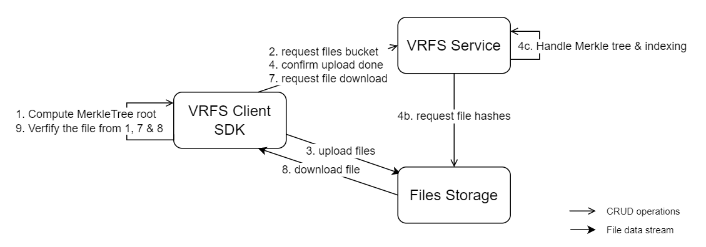
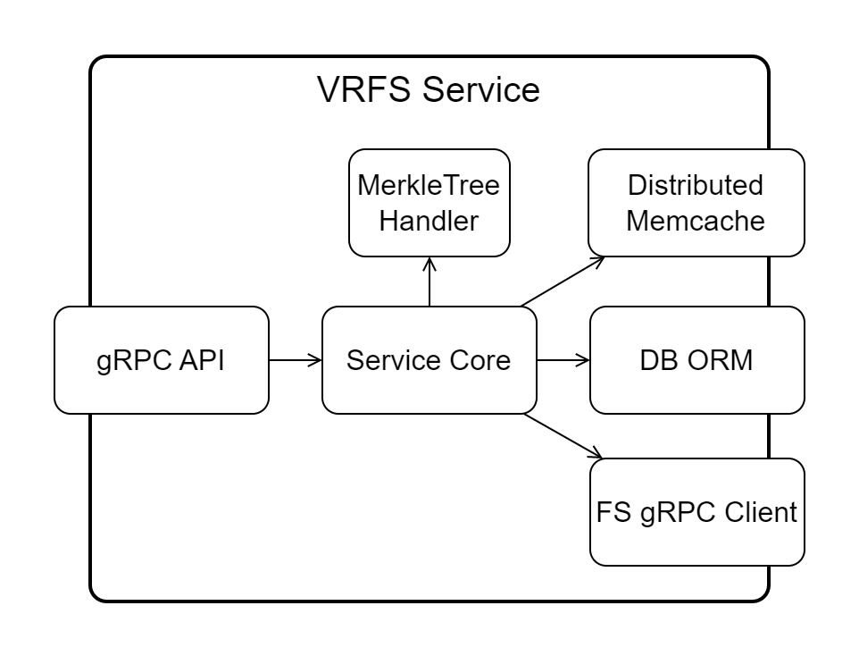
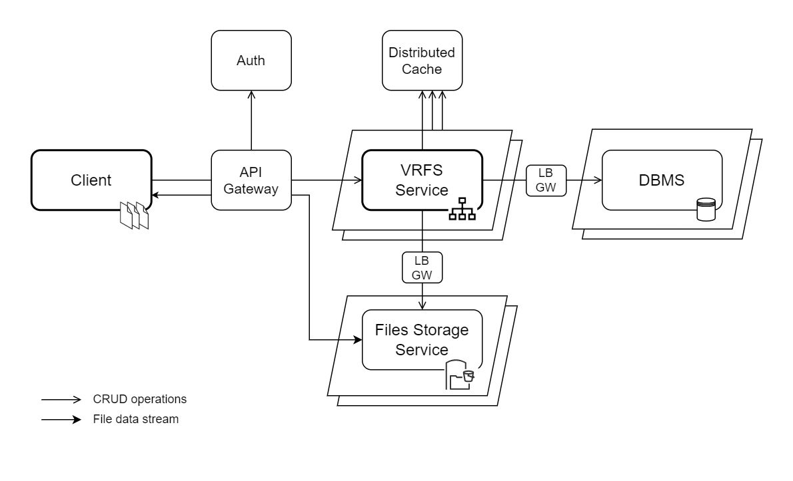

# Verifiable Remote Files Storage

## Purpose

### General

The Verifiable Remote File Storage service aims at checking the consistency of remotely stored files, uploaded as part of a fileset, then downloaded individually.

Files are verified as untampered on client side, based on the retrieved files' hash, the known MerkleTree root hash of the corresponding fileset and the MerkleTree proofs provided by the service for each file. After a verified upload, the client only needs to keep this 32-byte root, carried by the fileset ID.

The Merkle Tree root and proofs are computed by the VRFS service once the fileset has been uploaded on the FileStorage service. The proofs are stored only if the computed root matches the client's one.

Refer to the architecture [section](#protocol-overview) for more info about the opted protocol.

### Technical Insights

This is the mono-repository for the Go-based implementation of 2 backend services and 1 client CLI:

1. The VRFS API service - The core component of this protocol, exposing a gRPC API
2. A basic File Storage service exposing a gRPC API to batch upload files and download them individually. It also supports the retrieval of its stored files' hash.
3. A client CLI to execute the 2 main upload and download operations, along with a MerkleTree root computation and the proof-based file hash verifications

The gRPC protocol is used for optimal client-server and server-to-server communications.

During the upload and download operations, the files' data are streamed in chunks and a maximum upload chunk size can be specified. Interrupted transfers leave no partial file at their destination.

A complete docker compose setup enables an easy local build, deployment & run.

### Engineering Highlights

* **Concurrency:** [bounded upload workers](./client/app/uploader.go) with aggregated errors and signal-aware cancellation, checked with the race detector
* **gRPC streaming:** [chunked client and server streams](./client/rservice/ftservice.go), with an idle timeout that detects stalls without capping the transfer time
* **Storage integrity:** [temporary file, fsync and atomic rename](./vrfs-fs/service/file.go), so that only complete files are stored
* **Fail-closed verification:** a [downloaded file](./client/app/downloader.go) reaches its final path only once verified, and local files are deleted only after a confirmed root match
* **Security:** [strict validation](./vrfs-fs/service/server.go) of bucket IDs and file names against path traversal, on both server and client. Secrets stay out of the repository.
* **Testing:** unit and in-process [gRPC tests](./vrfs-fs/service/server_test.go) focused on failure paths: interruption, tampering, traversal, stalled streams and storage errors
* **Delivery:** Go workspace monorepo, multi-stage distroless Docker images, Docker Compose, and CI running vet, race tests and golangci-lint

## Architecture

### Protocol Overview

The overall implemented protocol for uploading or downloading local files to the remote file storage service, and have the files verified based on the generation of a Merkle Tree root and proofs for checking the leaf values (the file hashes here):



Key principles:

* The VRFS service is the entry point to the [external] FS service: it assigns the storage bucket of each fileset
* Files are directly uploaded to & downloaded from the FS service
* VRFS retrieves the file hashes from the FS server, for building its Merkle Tree and storing the corresponding proofs

Design motivations:

* Separation of concerns: storing the filesets (File Storage server) Vs. handling the files' verification process (VRFS API)
  * Independence towards the used files storage service, i.e. actual FS can be replaced by a 3rd party file storage solution
  * Corresponding micro-services cloud hosting platform instances can be customized per their core business requirements, i.e. their computation, bandwidth, memory requirements.
* Minimized bandwidth consumption: limited file transfers
  * With this design option, the fact that the file storage service exposes an API for retrieving the file bucket hashes is a key requirement since this avoids the need for the VRFS API to upload or download the files
  * Integrating a 3rd party solution would probably not support the provision of the file hashes. Integrating with an IPFS CID might be an option.
* Minimal client state: a constant-size root per fileset, and a logarithmic proof size per file

The considered alternative system architectures are reported in the diagram [VRFS design options](./doc/assets/VRFS_overview-design-options_v1.png).

This protocol results in:

* 6 steps to remotely store a fileset - 1 client command: 2 VRFS API requests, n file uploads & 1 VRFS->FS API request
* 3 steps to retrieve & verify a file - 1 client command: 1 VRFS API request & 1 file download

### VRFS Service Overview

Overview of the VRFS service main components:



### System Architecture

Overview of a considered scalable solution to be deployed:



## Instructions

### Quick Demo

A default playground directory [fs-playground](./fs-playground/) provides sample files, and demo scripts are available in the [Makefile](./Makefile).

```shell
# Create the local settings, then set your own Redis password in .env
$ cp .env.example .env

# Start the backend services
$ docker compose up --build -d

# Upload and verify the 201 sample files, then download and verify file #5
$ make demo-run-upload
$ make demo-run-download

# See tampering being detected: this download fails and keeps the verified copy
$ FILE=$(LC_ALL=C ls fs-playground/fs_client_files/tmock_fs-*/* | sed -n 6p)
$ echo tampered | sudo tee -a "$FILE" > /dev/null
$ make demo-run-download

# Remove the containers, their volumes and the demo files
$ docker compose down -v && make fs-playground-cleanup
```

### Running the Servers

Docker Compose builds & runs the 2 server modules and a Redis DB acting as a distributed KV cache. The Redis password is read from a local, git-ignored `.env` file, documented by [`.env.example`](./.env.example):

```shell
# Standard Docker Compose launch
$ docker compose up

# OR using a few custom config options. It creates .env from the example only if missing
$ make docker-compose-up

# Quick clean-up (removal) of the stopped Docker containers & images for this project
$ make docker-cleanup

# OR run the services locally, with Redis only in Docker
$ docker compose up -d vrfs-cache
$ go run ./vrfs-fs
$ go run ./vrfs-api
```

The multi-stage Dockerfiles of the [VRFS API](./vrfs-api/Dockerfile) and [File Storage](./vrfs-fs/Dockerfile) servers optimize build time through caching and produce [light](./doc/assets/shellshot_docker-image-ls.png) [distroless images](https://github.com/GoogleContainerTools/distroless). Notice there the monorepo specific `replace` requirements of the respective `go.mod` files.

### Running the Client CLI

A successful upload deletes the local directory once the remote fileset is verified. Local files are kept if any upload or the verification fails.

```shell
# List the available client CLI parameters
$ go run ./client -h

# Upload & verify all files of a local directory, with default service endpoints
$ go run ./client -action upload -updir ./fs-playground/forupload/catyclops

# Or by specifying the service endpoints and a max chunk size
$ go run ./client -action upload -updir ./fs-playground/forupload/catyclops \
    -api vrfs-api:50051 \
    -fs vrfs-fs:9000 \
    -chunk 1024

# Download & verify a file to an alternative directory. File indexes start at 0
$ go run ./client -action download \
    -fileset fs-10B..7E21 \
    -index 5 \
    -downdir ./fs-playground/downloaded
```

### Building & Testing

```shell
$ go build -o ./dist/vrfs-client ./client
$ go build -o ./dist/vrfs-server ./vrfs-api
$ go build -o ./dist/vrfs-fs ./vrfs-fs

$ go test -race ./client/... ./libs/merkletree/... ./libs/rpcapi/... ./vrfs-api/... ./vrfs-fs/...
```

### Modules Runtime Config

The client CLI is configurable via its command parameters, defined in the client [`main.go`](./client/main.go).

The VRFS & FS server configurations rely on their dedicated `yaml` file in [config](./config). Those parameters can be overridden via optional `.env` files or runtime environment variables, using [cleanenv](https://github.com/ilyakaznacheev/cleanenv) through the utility [`libs/config`](./libs/config/config.go). All settings have default values for an out-of-the-box experience, except the Redis password, which is never committed and must be provided through `REDIS_PASSWORD`.

## Development Framework

Pre-requisites:

* [Go](https://go.dev/doc/install) >= v1.21
* [Protocol buffer compiler](https://grpc.io/docs/protoc-installation/) >= v3 and the [gRPC Go plugins](https://grpc.io/docs/languages/go/quickstart/#prerequisites), to generate the client SDK and server API stubs
* [Docker](https://docs.docker.com/engine/install/) for running the backend services in containers
* `make` for benefiting from the available [`Makefile`](./Makefile) commands

Versions used while developing: Go `1.21.4`, protoc `3.12.4`, Docker `24.0.7`.

A Go workspace handles the different modules of this monorepo. Refer to [`go.work`](./go.work), and add a new module with `go work use ./moduleX`.

## Development Status

### Implemented

The depicted files' upload, download & verification protocol is implemented and finalized.

A persistence layer for the VRFS service is implemented via a distributed memory cache solution, using [Redis](https://redis.com/glossary/distributed-caching/), with periodic snapshots on a Docker volume. An additional DB ORM integration could be required, a NoSQL DB such as Mongo being an option. The serialization of the persisted MerkleTree proofs might also be further optimized.

The Merkle Tree computation models and settings are to be further refined and benchmarked, per the integration use case(s) and their computation, storage and transport requirements.

File hashes, the MerkleTree leaf values, use SHA2-256. Alternative hashing functions might be considered to optimize the computations runtime. The client and the FS server must use the same file hashing function, and the client and VRFS the same Merkle Tree settings.

### Known Limitations

| Limitation | Next step |
| --- | --- |
| Nested directories are flattened and can fail verification | Store relative paths |
| A fileset needs at least 2 files | Define a single-leaf tree |
| Upload confirmation trusts the hashes reported by storage, so a dishonest server is only caught at download | Challenge storage for file data before deleting local copies |
| A proof shows membership in the fileset, not the requested index | Check the proof path against the index |
| The leaf hash joins content and name without a delimiter | Length-prefix fields in a versioned format |
| Files are fully loaded in memory for hashing | Stream the hash computation |

### Production Readiness & Further Improvements

* **Access & traffic management:** no user authentication protects the service APIs yet. API keys or ECDSA signatures are the considered client authentication options. Load balancers and an API Gateway should handle requests routing, API versioning, encryption, private subnets and permissions, e.g. AWS ALB, AWS Cognito or Keycloak.
* **End-to-end TLS:** gRPC communications should rely on TLS, with X.509 certificates deployed at servers' level and secure connections initiated by the client, through `grpc.WithTransportCredentials`.
* **Logs reporting:** the services' JSON logs should be reported to a remote log watcher, e.g. [AWS CloudWatch](https://docs.aws.amazon.com/sdk-for-go/api/service/cloudwatch/) or [Sentry](https://github.com/getsentry/sentry-go), to monitor the services and automate alerts.
* **Services monitoring:** servers should report their usage & performance statistics to a Prometheus-like time series database, with a monitoring dashboard, e.g. Grafana, and runtime alerts management.
* **API versions management:** a basic mechanism covers the Protobuf-based gRPC stubs, the Docker image tags (semver CLI) and the services' configured version. Its integration is to be pushed further.
* **Automated tests & delivery:** unit and gRPC integration tests run in CI with the race detector. Automated E2E tests and a continuous deployment flow should be added.
* **CLI client:** a Cobra-like integration and a client-side logs manager should be considered if the CLI is given a priority.

## Credits

The Merkle Tree support has been originally developed by Tommy TIAN as of March 2023, in [txaty/go-merkletree](https://github.com/txaty/go-merkletree), distributed under the [MIT license](./libs/merkletree/LICENSE_go-merkletree). Minor packaging changes have been made, and custom config and fileset specific utilities extend the original implementation.

## License

The GNU Affero General Public License version 3 (AGPL v3, 2007) applies to this mono-repository and all of its software modules.

You can refer to the dedicated [license](./LICENSE.md) files, and to the [project notice](./LICENSE_VRFS).
